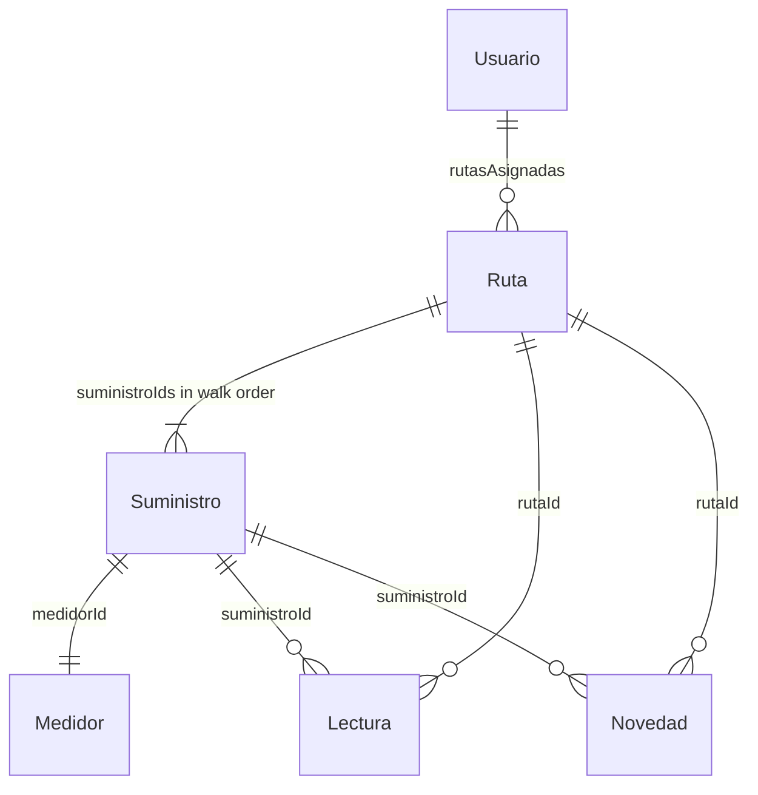

# Entities

[Index](./README.md) · previous: [05-data-and-api.md](./05-data-and-api.md) · next: [07-open-questions.md](./07-open-questions.md)

What the app stores and shows. The types below are the contract. Copy them once ([DT-01](./05-data-and-api.md#dt-01)). Do not add fields to paper over a gap in [07-open-questions.md](./07-open-questions.md).

Type names and field names stay in Spanish. They are the API. Files that hold them are English, under `src/types/`.



`Lectura` and `Novedad` stay separate. A reading has a number and produces a bill. An incident explains why there is no number. Merging them forces every screen to ask "does this have a value or not?".

How many readings or incidents one supply can have inside one route is unstated. [P-07](./07-open-questions.md#p-07).

## Shared types

```ts
export interface Coordenadas {
  latitud: number
  longitud: number
}

export type Categoria = 'residencial' | 'comercial' | 'industrial' | 'rural'

export type ModeloMedidor = 'agujas' | 'agujas_viejo' | 'digital' | 'multiplicador'

export type EstadoRuta = 'asignada' | 'en_curso' | 'cerrada'

export type MotivoNovedad =
  | 'perro_suelto'
  | 'porton_cerrado'
  | 'pasto_alto'
  | 'medidor_tapado'
  | 'medidor_roto'
  | 'deshabitada'
  | 'no_se_encuentra'

export type Rol = 'lector' | 'administracion'
```

Screen labels for `MotivoNovedad`, in PRD order:

| Value | Label |
| --- | --- |
| `perro_suelto` | Perro suelto |
| `porton_cerrado` | Portón cerrado |
| `pasto_alto` | Pasto o maleza |
| `medidor_tapado` | Medidor tapado |
| `medidor_roto` | Medidor roto |
| `deshabitada` | Vivienda deshabitada |
| `no_se_encuentra` | No se encuentra el medidor |

## Suministro

A water connection: a house, a shop, a shed. The unit that is read and billed.

| Property | Type | Example |
| --- | --- | --- |
| `id` | `string` | `"sum-004120"` |
| `numero` | `string` | `"004120"` |
| `titular` | `string` | `"Coronel, Ramona"` |
| `direccion` | `string` | `"Brasil 1420"` |
| `coordenadas` | `Coordenadas` | `{ latitud: -30.75, longitud: -57.98 }` |
| `categoria` | `Categoria` | `"residencial"` |
| `medidorId` | `string` | `"med-A88413"` |
| `lecturaAnterior` | `number \| null` | `1284` |
| `fechaLecturaAnterior` | `string \| null` | `"2026-07-14T09:30:00-03:00"` |
| `consumoPromedio` | `number \| null` | `18` (m³ per two-month period) |
| `activo` | `boolean` | `true` |

```ts
export interface Suministro {
  id: string
  numero: string
  titular: string
  direccion: string
  coordenadas: Coordenadas
  categoria: Categoria
  medidorId: string
  lecturaAnterior: number | null
  fechaLecturaAnterior: string | null
  consumoPromedio: number | null
  activo: boolean
}
```

```json
{
  "id": "sum-004120",
  "numero": "004120",
  "titular": "Coronel, Ramona",
  "direccion": "Brasil 1420",
  "coordenadas": { "latitud": -30.7521, "longitud": -57.9814 },
  "categoria": "residencial",
  "medidorId": "med-A88413",
  "lecturaAnterior": 1284,
  "fechaLecturaAnterior": "2026-07-14T09:30:00-03:00",
  "consumoPromedio": 18,
  "activo": true
}
```

`lecturaAnterior` and `fechaLecturaAnterior` are `null` when the connection is new. There is no series of earlier periods: only the average. [P-02](./07-open-questions.md#p-02).

## Medidor

| Property | Type | Example |
| --- | --- | --- |
| `id` | `string` | `"med-A88413"` |
| `serie` | `string` | `"A-88413"` |
| `modelo` | `ModeloMedidor` | `"agujas"` |
| `multiplicador` | `number` | `1`, or `10` on the old ones |
| `digitos` | `number` | `5` |
| `videoInstructivoUrl` | `string \| null` | video of how to read this model |
| `codigoQr` | `string \| null` | `"COOP-CHJ:med-A88413"` |
| `instaladoEn` | `string` | `"2019-03-11T00:00:00-03:00"` |

```ts
export interface Medidor {
  id: string
  serie: string
  modelo: ModeloMedidor
  multiplicador: number
  digitos: number
  videoInstructivoUrl: string | null
  codigoQr: string | null
  instaladoEn: string
}
```

```json
{
  "id": "med-A88413",
  "serie": "A-88413",
  "modelo": "agujas",
  "multiplicador": 1,
  "digitos": 5,
  "videoInstructivoUrl": "https://api.coopchajari.com.ar/v/agujas.mp4",
  "codigoQr": "COOP-CHJ:med-A88413",
  "instaladoEn": "2019-03-11T00:00:00-03:00"
}
```

Real consumption is `(lectura - anterior) * multiplicador`. The multiplier lives on the meter, not on the reading ([DT-10](./05-data-and-api.md#dt-10)).

## Ruta

| Property | Type | Example |
| --- | --- | --- |
| `id` | `string` | `"rut-07-2026-05"` |
| `numero` | `string` | `"07"` |
| `nombre` | `string` | `"Barrio Brasil"` |
| `bimestre` | `string` | `"2026-05"` |
| `lectorId` | `string` | `"usr-011"` |
| `suministroIds` | `string[]` | in walk order |
| `estado` | `EstadoRuta` | `"en_curso"` |
| `descargadaEn` | `string \| null` | `"2026-09-15T07:40:00-03:00"` |
| `cerradaEn` | `string \| null` | `null` |

```ts
export interface Ruta {
  id: string
  numero: string
  nombre: string
  bimestre: string
  lectorId: string
  suministroIds: string[]
  estado: EstadoRuta
  descargadaEn: string | null
  cerradaEn: string | null
}
```

```json
{
  "id": "rut-07-2026-05",
  "numero": "07",
  "nombre": "Barrio Brasil",
  "bimestre": "2026-05",
  "lectorId": "usr-011",
  "suministroIds": ["sum-004118", "sum-004120", "sum-004136"],
  "estado": "en_curso",
  "descargadaEn": "2026-09-15T07:40:00-03:00",
  "cerradaEn": null
}
```

`bimestre` is noted as `"AAAA-NN"`. The example `"2026-05"` does not say whether `05` is May or the 5th period. [P-18](./07-open-questions.md#p-18).

`suministroIds` is the walk. It is not reordered ([RF-06](./02-requirements.md#rf-06)).

## Lectura

| Property | Type | Example |
| --- | --- | --- |
| `id` | `string` | `"lec-88201"` |
| `rutaId` | `string` | `"rut-07-2026-05"` |
| `suministroId` | `string` | `"sum-004120"` |
| `lectorId` | `string` | `"usr-011"` |
| `valor` | `number` | `1302` |
| `consumo` | `number` | `18` |
| `fotoUri` | `string` | local until it uploads |
| `coordenadas` | `Coordenadas \| null` | where it was entered |
| `fueraDeRango` | `boolean` | `false` |
| `confirmadaPorLector` | `boolean` | `false` |
| `fechaHora` | `string` | `"2026-09-15T08:12:00-03:00"` |
| `sincronizada` | `boolean` | `false` |

```ts
export interface Lectura {
  id: string
  rutaId: string
  suministroId: string
  lectorId: string
  valor: number
  consumo: number
  fotoUri: string
  coordenadas: Coordenadas | null
  fueraDeRango: boolean
  confirmadaPorLector: boolean
  fechaHora: string
  sincronizada: boolean
}
```

`valor` is the number as seen on the meter. `consumo` is `(valor - anterior) * multiplicador`. `confirmadaPorLector` is `true` when the app warned and the reader confirmed anyway.

```json
{
  "id": "lec-88201",
  "rutaId": "rut-07-2026-05",
  "suministroId": "sum-004120",
  "lectorId": "usr-011",
  "valor": 1302,
  "consumo": 18,
  "fotoUri": "file:///.../lecturas/lec-88201.jpg",
  "coordenadas": { "latitud": -30.7521, "longitud": -57.9813 },
  "fueraDeRango": false,
  "confirmadaPorLector": false,
  "fechaHora": "2026-09-15T08:12:00-03:00",
  "sincronizada": false
}
```

## Novedad

| Property | Type | Example |
| --- | --- | --- |
| `id` | `string` | `"nov-3312"` |
| `rutaId` | `string` | `"rut-07-2026-05"` |
| `suministroId` | `string` | `"sum-004150"` |
| `lectorId` | `string` | `"usr-011"` |
| `motivo` | `MotivoNovedad` | `"perro_suelto"` |
| `comentario` | `string \| null` | `"Dos perros grandes sueltos"` |
| `audioUri` | `string \| null` | voice note, if they recorded one |
| `fotoUri` | `string` | required |
| `fechaHora` | `string` | `"2026-09-15T08:31:00-03:00"` |
| `sincronizada` | `boolean` | `false` |

```ts
export interface Novedad {
  id: string
  rutaId: string
  suministroId: string
  lectorId: string
  motivo: MotivoNovedad
  comentario: string | null
  audioUri: string | null
  fotoUri: string
  fechaHora: string
  sincronizada: boolean
}
```

```json
{
  "id": "nov-3312",
  "rutaId": "rut-07-2026-05",
  "suministroId": "sum-004150",
  "lectorId": "usr-011",
  "motivo": "perro_suelto",
  "comentario": null,
  "audioUri": "file:///.../novedades/nov-3312.m4a",
  "fotoUri": "file:///.../novedades/nov-3312.jpg",
  "fechaHora": "2026-09-15T08:31:00-03:00",
  "sincronizada": false
}
```

In the example, `comentario` is `null` and there is audio. Both may be empty at once: the PRD asks for the ability to add a note, and does not require one of the two. The photo is required (`fotoUri: string`).

## Usuario

| Property | Type | Example |
| --- | --- | --- |
| `id` | `string` | `"usr-011"` |
| `legajo` | `string` | `"L-011"` |
| `nombre` | `string` | `"Ramón Duarte"` |
| `rol` | `Rol` | `"lector"` |
| `biometriaActiva` | `boolean` | `true` |
| `rutasAsignadas` | `string[]` | `["rut-07-2026-05"]` |

```ts
export interface Usuario {
  id: string
  legajo: string
  nombre: string
  rol: Rol
  biometriaActiva: boolean
  rutasAsignadas: string[]
}
```

```json
{
  "id": "usr-011",
  "legajo": "L-011",
  "nombre": "Ramón Duarte",
  "rol": "lector",
  "biometriaActiva": true,
  "rutasAsignadas": ["rut-07-2026-05"]
}
```

This entity has no email, no password, and no token. The token lives in `expo-secure-store` ([DT-11](./05-data-and-api.md#dt-11)).

[Index](./README.md) · previous: [05-data-and-api.md](./05-data-and-api.md) · next: [07-open-questions.md](./07-open-questions.md)
